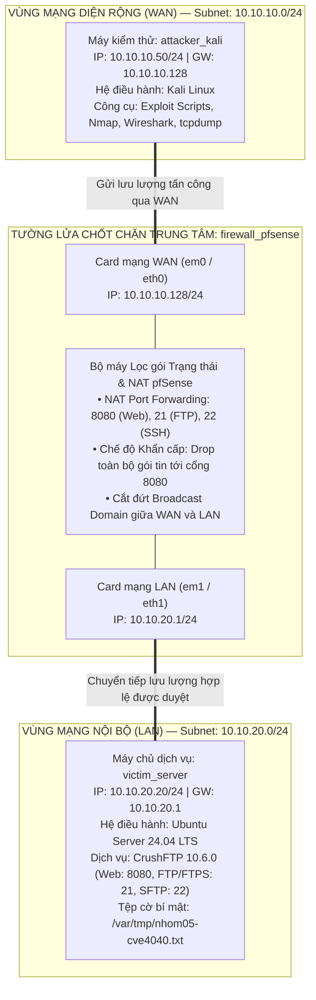

# BÀI TẬP LỚN MÔN AN TOÀN MẠNG (INT1482)
# ĐỀ TÀI: AN TOÀN DỊCH VỤ TRUYỀN NHẬN TỆP (CRUSHFTP 10.6.0)

<p align="center">
  <b>HỌC VIỆN CÔNG NGHỆ BƯU CHÍNH VIỄN THÔNG (PTIT)</b><br>
  <b>KHOA AN TOÀN THÔNG TIN</b><br>
  <i>Học kỳ 1 — Năm học 2025 - 2026</i>
</p>

<p align="center">
  
  
  
  
  
</p>

---

## THÔNG TIN CHUNG VỀ DỰ ÁN

* **Cơ sở đào tạo:** Học viện Công nghệ Bưu chính Viễn thông (Cơ sở Hà Nội)
* **Khoa phụ trách:** Khoa An toàn Thông tin
* **Học phần:** An toàn mạng — **Mã học phần:** INT1482
* **Mã lớp:** INT1482-20261-02
* **Giảng viên hướng dẫn:** TS. Nguyễn Ngọc Điệp
* **Phân công nhiệm vụ nhóm thực hiện:**

| TT | Công việc / Nhiệm vụ | SV thực hiện |
| :---: | :--- | :--- |
| 1 | • Điều phối, theo dõi tiến độ hoàn thành Demo.<br>• Thiết kế cấu hình phân vùng mạng và quy hoạch IP.<br>• Chịu trách nhiệm cài đặt cấu hình mạng lõi.<br>• Tổng hợp báo cáo chung. | **Ngô Quý Trường Giang** (MSV: B23DCAT080) |
| 2 | • Khảo sát lý thuyết về quản lý bản vá và quy trình 6 bước khắc phục lỗ hổng.<br>• Chịu trách nhiệm chính trong việc thiết lập hệ thống phòng thủ, cài đặt các bản vá lỗi cho cả 2 hệ thống FTP. | **Đặng Trần Hải Đăng** (MSV: B23DCAT036) |
| 3 | • Phân tích chi tiết CVE-2024-4040.<br>• Chịu trách nhiệm cài đặt phiên bản Wing FTP Server bị lỗi và chạy mã PoC khai thác lỗ hổng này trong Demo. Thu thập log và đánh giá rủi ro. | **Trần Quốc Khánh** (MSV: B23DCAT150) |
| 4 | • Phân tích chi tiết CVE-2025-54309.<br>• Chịu trách nhiệm cài đặt CrushFTP và thực hiện khai thác lỗ hổng bypass xác thực trong Demo. | **Trần Huy Hoàng** (MSV: B23DCAT115) |
| 5 | • Tổng hợp báo cáo, vẽ sơ đồ cấu hình mạng bằng phần mềm.<br>• Thu thập ảnh chụp màn hình minh chứng cho Demo. Đảm bảo form mẫu báo cáo chuẩn chỉ. | **Nguyễn Thị Ngọc Anh** (MSV: B23DCAT015) |

---

## MỤC LỤC TỔNG QUAN
1. [Giới thiệu Khái quát & Bối cảnh Đề tài](#1-giới-thiệu-khái-quát--bối-cảnh-đề-tài)
2. [Mục tiêu và Phạm vi Nghiên cứu](#2-mục-tiêu-và-phạm-vi-nghiên-cứu)
3. [Cấu trúc Kho lưu trữ Repository](#3-cấu-trúc-kho-lưu-trữ-repository)
4. [Mô hình Kiến trúc Phân vùng An ninh Hệ thống](#4-mô-hình-kiến-trúc-phân-vùng-an-ninh-hệ-thống)
5. [Tóm tắt Kết quả Nghiên cứu & Thực nghiệm Chính](#5-tóm-tắt-kết-quả-nghiên-cứu--thực-nghiệm-chính)
   - 5.1. [Nghiên cứu Giao thức & Phân tích Nguy cơ Rò rỉ Dữ liệu](#51-nghiên-cứu-giao-thức--phân-tích-nguy-cơ-rò-rỉ-dữ-liệu)
   - 5.2. [Phân tích & Tái hiện Khai thác 2 Lỗ hổng Trọng yếu (CVE-2024-4040 & CVE-2025-54309)](#52-phân-tích--tái-hiện-khai-thác-2-lỗ-hổng-trọng-yếu-cve-2024-4040--cve-2025-54309)
   - 5.3. [Giải pháp Phòng thủ Đa tầng & Kết quả Thực nghiệm Đối chiếu](#53-giải-pháp-phòng-thủ-đa-tầng--kết-quả-thực-nghiệm-đối-chiếu)
6. [Hướng dẫn Khởi chạy Lab Thực nghiệm (Docker & VMware)](#6-hướng-dẫn-khởi-chạy-lab-thực-nghiệm-docker--vmware)
7. [Kịch bản Demo Thực nghiệm Đối chiếu (2 Giai đoạn)](#7-kịch-bản-demo-thực-nghiệm-đối-chiếu-2-giai-đoạn)
8. [Bài học Kinh nghiệm & Hướng Phát triển](#8-bài-học-kinh-nghiệm--hướng-phát-triển)
9. [Tài liệu Tham khảo Chính](#9-tài-liệu-tham-khảo-chính)

---

## 1. Giới thiệu Khái quát & Bối cảnh Đề tài

Trong kỷ nguyên chuyển đổi số, **Dịch vụ truyền nhận tệp (File Transfer Services)** là huyết mạch kết nối giữa các chi nhánh, máy chủ dữ liệu và đối tác kinh doanh trong các doanh nghiệp, tổ chức tài chính và cơ quan nhà nước. Mỗi ngày, hàng triệu tệp tin chứa dữ liệu kinh doanh, báo cáo tài chính, chứng từ điện tử và thông tin nhạy cảm của khách hàng được luân chuyển qua hạ tầng mạng.

Tuy nhiên, bức tranh an ninh mạng đối với dịch vụ này đang tồn tại những nguy cơ nghiêm trọng:
1. **Sự tồn dư của các giao thức truyền thống thiếu an toàn:** Giao thức FTP cổ điển (RFC 959) ra đời từ năm 1985 khi môi trường mạng chưa có các đe dọa an ninh, dẫn đến việc truyền toàn bộ định danh, mật khẩu và nội dung tệp dưới dạng văn bản rõ (*plaintext*), tạo điều kiện cho các cuộc tấn công nghe lén (*Sniffing*) và tấn công xen giữa (*Man-in-the-Middle - MITM*).
2. **Sự phơi nhiễm từ các phần mềm máy chủ đa giao thức thương mại:** Nhằm đáp ứng nhu cầu quản trị hiện đại, các giải pháp máy chủ như **CrushFTP** (hỗ trợ FTP, FTPS, SFTP, WebDAV, AS2) đã bổ sung giao diện quản trị Web (WebInterface) và các cổng tiếp nhận giao dịch kinh doanh điện tử (AS2). Chính những tiện ích mở rộng này đã làm gia tăng đáng kể bề mặt tấn công tầng ứng dụng.
3. **Các lỗ hổng nghiêm trọng bùng nổ trong thực tế:**
   - **CVE-2024-4040 (CVSS 9.8 - Critical):** Lỗ hổng chèn mẫu từ phía máy chủ (Server-Side Template Injection - SSTI) cho phép kẻ tấn công chưa xác thực thoát khỏi phân vùng thư mục ảo (VFS Sandbox Escape) và đọc bất kỳ tệp tin nhạy cảm nào trên hệ điều hành máy chủ.
   - **CVE-2025-54309:** Lỗ hổng tương tranh thời gian (Race Condition) trong logic xác thực giao thức AS2 qua HTTPS, cho phép đối tượng từ xa vượt qua xác thực để chiếm đoạt phiên quản trị máy chủ.

Nhận thức sâu sắc tính cấp bách trên, **Nhóm 05** đã thực hiện đề tài bài tập lớn nhằm nghiên cứu toàn diện từ cơ sở lý thuyết, phân tích bề mặt tấn công, thực nghiệm khai thác lỗ hổng cho đến xây dựng giải pháp phòng thủ đa tầng bền vững.

---

## 2. Mục tiêu và Phạm vi Nghiên cứu

### Mục tiêu tổng quát
Khảo sát, phân tích và làm chủ các kỹ thuật bảo đảm an toàn cho dịch vụ truyền nhận tệp trong doanh nghiệp; chứng minh các nguy cơ bảo mật thông qua thực nghiệm tấn công đối chứng; từ đó xây dựng kiến trúc phòng thủ mạng kết hợp giữa **mã hóa kênh truyền** và **phân vùng an ninh bằng tường lửa pfSense**.

### Các mục tiêu cụ thể
* **Về mặt Lý thuyết:**
  - Nghiên cứu kiến trúc hai kênh (kênh điều khiển cổng 21 và kênh dữ liệu) cùng cơ chế hoạt động Active Mode / Passive Mode của giao thức FTP.
  - Phân tích rủi ro của dữ liệu truyền không mã hóa và phân tích chuyên sâu các giải pháp an toàn thay thế (FTPS và SFTP).
  - Phân tích bề mặt tấn công 3 tầng: Tầng mạng & giao thức, Tầng ứng dụng máy chủ và Tầng cấu hình quyền hạn.
  - Mổ xẻ chi tiết nguyên nhân gốc rễ (Root Cause) của 2 lỗ hổng an ninh điển hình trên CrushFTP: CVE-2024-4040 và CVE-2025-54309.
* **Về mặt Thực nghiệm & Kỹ thuật:**
  - Xây dựng mô hình kiểm thử mạng phân vùng đa tầng chuẩn hóa trên cả 2 nền tảng: **Docker Compose** (tự động hóa cao, chạy offline) và **VMware Workstation** (mô phỏng sát thực tế doanh nghiệp với pfSense 2.7.2).
  - Tái hiện thành công kịch bản nghe lén bắt dữ liệu văn bản rõ qua Wireshark.
  - Viết mã khai thác (Exploit Scripts) và thực nghiệm thành công việc đọc tệp cờ bí mật `/var/tmp/nhom05-cve4040.txt` và trích xuất tài khoản quản trị CrushFTP.
* **Về mặt Phòng thủ & Đánh giá:**
  - Triển khai dịch vụ truyền tệp an toàn qua SFTP (OpenSSH cổng 22) và FTPS (TLS 1.3).
  - Thiết lập bộ quy tắc kiểm soát gói tin trạng thái (Stateful Packet Inspection) trên pfSense, cô lập Broadcast Domain và kích hoạt cơ chế chặn đứng khẩn cấp cổng dịch vụ Web 8080.
  - Xây dựng bảng đối chiếu kết quả thực nghiệm Trước và Sau khi kích hoạt phòng thủ để đánh giá tính hiệu quả.

---

## 3. Cấu trúc Kho lưu trữ Repository

```
BTL_ATM/
│
├── README.md                                  <-- [TÀI LIỆU NÀY] Cổng thông tin & tổng quan toàn bộ dự án
├── nhom05_atm_lab_final.tar                   <-- Gói ảnh Docker 3 máy đóng gói sẵn (~434 MB, chạy Offline)
├── document/                                  <-- Thư mục chứa tài liệu báo cáo nghiệm thu
├── video_demo/                                <-- Thư mục video ghi lại quá trình thực nghiệm đối chiếu
│
├── kich_ban_lab_docker/                       <-- Môi trường thực nghiệm tự động hóa bằng Docker Compose
│   ├── docker-compose.yml                     <-- Cấu hình 3 node mạng: WAN (Attacker) - pfSense - LAN (CrushFTP)
│   ├── docker-compose.flat.yml                <-- Cấu hình mạng phẳng kiểm chứng tấn công nghe lén FTP
│   ├── bat_phong_thu.bat / .ps1               <-- Kích hoạt luật tường lửa pfSense DROP cổng 8080
│   ├── tat_phong_thu.bat / .ps1               <-- Mở lại cổng 8080 để kiểm thử lại tấn công
│   ├── README_DOCKER.md                       <-- Cẩm nang vận hành chi tiết lab Docker
│   ├── firewall/                              <-- Router Firewall mô phỏng pfSense (iptables SPI)
│   ├── attacker/                              <-- Máy kiểm thử Kali Linux (chứa các script exploit)
│   │   └── exploits/                          <-- Script khai thác CVE-2024-4040, CVE-2025-54309, scan...
│   └── victim/                                <-- Máy chủ Ubuntu Server chạy CrushFTP 10.6.0
│
└── kich_ban_lab_vmware_pfsense/               <-- Môi trường thực nghiệm trên VMware Workstation
    ├── pfSense_Config_Backup_Nhom05.xml       <-- Tệp sao lưu cấu hình chuẩn của pfSense 2.7.2
    └── README_VMWARE_PFSENSE.md               <-- Cẩm nang cấu hình VMnet2/VMnet3 trên VMware
```

---

## 4. Mô hình Kiến trúc Phân vùng An ninh Hệ thống

Hệ thống lab được thiết kế theo đúng kiến trúc phân vùng an ninh mạng đa tầng trong doanh nghiệp, lấy tường lửa **pfSense** làm chốt chặn kiểm soát trung tâm (tương ứng Hình 10 trong Báo cáo BTL):



### Bảng Quy hoạch Tham số Mạng & Vai trò Các Node

| Tên Node | Card Mạng | Địa chỉ IP Gán | Default Gateway | Chức năng & Vai trò trong Dự án |
| :--- | :--- | :--- | :--- | :--- |
| **`attacker_kali`** | Card WAN | `10.10.10.50/24` | `10.10.10.128` | Đóng vai kẻ tấn công ngoài Internet / đối tác chưa được định danh; thực thi các script khai thác lỗ hổng và rà soát lưu lượng mạng. |
| **`firewall_pfsense`** | Card WAN<br>Card LAN | `10.10.10.128/24`<br>`10.10.20.1/24` | *Host Gateway* | Router biên trung tâm, thực hiện kiểm soát truy cập (Stateful Firewall), ánh xạ cổng (NAT Port Forwarding) và cô lập hoàn toàn Broadcast Domain giữa 2 phân đoạn mạng. |
| **`victim_server`** | Card LAN | `10.10.20.20/24` | `10.10.20.1` | Máy chủ nội bộ lưu trữ dữ liệu tệp tin doanh nghiệp, triển khai CrushFTP 10.6.0 cung cấp giao diện Web quản trị, dịch vụ FTP, FTPS và SFTP. |

---

## 5. Tóm tắt Kết quả Nghiên cứu & Thực nghiệm Chính

### 5.1. Nghiên cứu Giao thức & Phân tích Nguy cơ Rò rỉ Dữ liệu

Dự án đã tiến hành đối chiếu và kiểm chứng thực tế giữa 3 giao thức truyền nhận tệp phổ biến nhất:

| Tiêu chí So sánh | FTP truyền thống (RFC 959) | FTPS (RFC 4217) | SFTP (RFC 4253 / SSH) |
| :--- | :--- | :--- | :--- |
| **Kênh điều khiển** | ❌ Plaintext (Văn bản rõ) | ✔️ Mã hóa TLS 1.3 | ✔️ Mã hóa đường hầm SSH |
| **Kênh dữ liệu** | ❌ Plaintext (Văn bản rõ) | ✔️ Mã hóa TLS (`PROT P`) | ✔️ Mã hóa gói tin nhị phân |
| **Bảo vệ Mật khẩu** | ❌ Hiển thị trực tiếp (`PASS admin123`) | ✔️ Bảo mật tuyệt đối | ✔️ Bảo vệ qua Mật khẩu hoặc Khóa SSH |
| **Số lượng cổng** | 2 kết nối (Cổng 21 + Cổng dữ liệu động) | 2 kết nối (Cổng 21/990 + Dải Passive) | **1 cổng duy nhất (TCP 22)** |
| **Khả năng vượt NAT/FW** | Kém, dễ bị chặn kênh dữ liệu ở Active Mode | Trung bình, đòi hỏi mở dải cổng Passive | **Xuất sắc, cấu hình cực kỳ đơn giản** |
| **Tính toàn vẹn dữ liệu** | ❌ Hoàn toàn không có | ✔️ Kiểm soát bằng HMAC qua TLS | ✔️ Kiểm soát bằng HMAC qua SSH |

> **Thực nghiệm Wireshark đối chứng:** Khi bắt gói tin FTP trên môi trường mạng phẳng, công cụ Wireshark thông qua tính năng *Follow TCP Stream* đã tái tạo lại toàn bộ tài khoản đăng nhập `crushadmin` và nội dung tệp tin văn bản `mau.txt`. Ngược lại, khi chuyển sang SFTP/FTPS, toàn bộ nội dung chỉ là chuỗi byte nhị phân ngẫu nhiên được mã hóa mạnh mẽ.

---

### 5.2. Phân tích & Tái hiện Khai thác 2 Lỗ hổng Trọng yếu (CVE-2024-4040 & CVE-2025-54309)

Nhóm đã nghiên cứu sâu vào mã nguồn và cấu trúc API của CrushFTP để giải thích bản chất kỹ thuật của 2 lỗ hổng an ninh:

#### 1. Lỗ hổng CVE-2024-4040 (SSTI & VFS Sandbox Escape — CVSS 9.8 Critical)
* **Nguyên nhân gốc rễ:** Engine xử lý mẫu nội bộ của CrushFTP hỗ trợ cú pháp thẻ đặc biệt `<INCLUDE>/duong/dan/tep</INCLUDE>`. Khi gặp thẻ này, máy chủ tự động truy cập trực tiếp vào hệ thống tệp của OS và nhúng nội dung tệp vào phản hồi XML trả về.
* **Cơ chế lỗi:** Tại endpoint `/WebInterface/function/` với lệnh `command=exists`, tham số `paths` hoàn toàn **không được lọc/khử khuẩn** đối với thẻ `<INCLUDE>`.
* **Điểm yếu CSRF `c2f`:** Token chống CSRF `c2f` được CrushFTP lấy trực tiếp từ **4 ký tự cuối của cookie `CrushAuth`** mà server tự cấp cho phiên ẩn danh. Kẻ tấn công không cần đăng nhập vẫn tự tính được token hợp lệ.
* **Kết quả khai thác:** Kẻ tấn công gửi request với payload:
  `command=exists&paths=<INCLUDE>/var/tmp/nhom05-cve4040.txt</INCLUDE>&c2f=xxxx`
  Máy chủ trả về nội dung cờ bí mật: **`NHOM05-CVE4040-LAB-ONLY`**.

#### 2. Lỗ hổng CVE-2025-54309 (Race Condition AS2 Authentication Bypass)
* **Nguyên nhân gốc rễ:** Giao thức AS2 được dùng để trao đổi chứng từ điện tử qua HTTPS. Khi cấu hình CrushFTP đứng trực tiếp mà không có tầng DMZ Proxy bảo vệ, logic gán quyền phiên làm việc (*Session Context Binding*) xuất hiện điều kiện tương tranh (Race Condition).
* **Kết quả khai thác:** Kẻ tấn công phát chuỗi burst request đồng thời trong thời gian cực ngắn ($<10\,\text{ms}$) làm xung đột tài nguyên, khiến máy chủ cấp phát phiên làm việc với đặc quyền Admin rỗng. Từ session này, kẻ tấn công gọi API nội bộ và trích xuất thành công danh sách người dùng quản trị: `crushadmin`, `default`, `TempAccount`.

---

### 5.3. Giải pháp Phòng thủ Đa tầng & Kết quả Thực nghiệm Đối chiếu

Dự án đã triển khai và chứng minh tính hiệu quả của chiến lược phòng thủ phối hợp:

```
[Mạng Ngoài WAN]
       │
       ▼
┌────────────────────────────────────────────────────────┐
│  LỚP 1: TƯỜNG LỬA TRUNG TÂM (PFSENSE)                   │
│  - Phân vùng mạng độc lập, cô lập Broadcast Domain     │
│  - Cơ chế Drop cổng 8080 (bat_phong_thu) chặn đứng SYN │
└────────────────────────────────────────────────────────┘
       │
       ▼
┌────────────────────────────────────────────────────────┐
│  LỚP 2: MÃ HÓA KÊNH TRUYỀN (FTPS / SFTP)                │
│  - Chuyển toàn bộ luồng truyền tệp sang SSH Port 22    │
│  - Vô hiệu hóa nguy cơ bắt trộm dữ liệu qua Wireshark  │
└────────────────────────────────────────────────────────┘
```

#### Bảng tổng hợp đối chiếu kết quả Trước và Sau phòng thủ

| Kịch bản Kiểm thử | Giai đoạn 1: Chưa bật phòng thủ (Mạng phẳng / Không mã hóa) | Giai đoạn 2: Kích hoạt phòng thủ (pfSense Drop 8080 + SFTP) | Đánh giá Mức độ An toàn |
| :--- | :--- | :--- | :--- |
| **Bắt gói tin FTP tìm mật khẩu** | ❌ Lộ rõ `USER crushadmin` / `PASS admin123` | ✔️ Dữ liệu được mã hóa hoàn toàn qua SFTP / SSHv2 | Triệt tiêu hoàn toàn nguy cơ Sniffing |
| **Trích xuất nội dung tệp tin** | ❌ Đọc nguyên vẹn nội dung file `mau.txt` | ✔️ Tải trọng hiển thị dạng nhị phân mã hóa vô nghĩa | Đảm bảo 100% tính bảo mật dữ liệu |
| **Khai thác SSTI CVE-2024-4040** | ❌ Thành công: Đọc được cờ bí mật trên OS | ✔️ Thất bại: Gói tin bị pfSense DROP $\rightarrow$ `ConnectTimeout` | Ngăn chặn kẻ tấn công chạm vào ứng dụng |
| **Khai thác AS2 CVE-2025-54309** | ❌ Thành công: Trích xuất toàn bộ user Admin | ✔️ Thất bại: Không thể kết nối tới WebInterface cổng 8080 | Bảo vệ tuyệt đối quyền quản trị hệ thống |
| **Nghe lén lưu lượng vùng LAN** | ❌ Bắt được gói tin của toàn bộ mạng | ✔️ pfSense cô lập Broadcast, ngoài WAN không thấy gì | Ngăn chặn hiện tượng tràn lưu lượng nội bộ |

---

## 6. Hướng dẫn Khởi chạy Lab Thực nghiệm (Docker & VMware)

### Cách 1: Khởi chạy nhanh bằng Docker Compose (Khuyên dùng)
Tải ảnh đóng gói sẵn tại mục [Releases](https://github.com/Snoopyz1/BTL_ATM/releases): `nhom05_atm_lab_final.tar`.

Mở PowerShell tại thư mục `kich_ban_lab_docker`:
```powershell
# 1. Nạp ảnh Docker (chỉ làm 1 lần)
docker load -i nhom05_atm_lab_final.tar

# 2. Khởi động toàn bộ 3 máy container
docker compose up -d
```
* Mở trình duyệt kiểm tra máy chủ: `http://localhost:8080` (Tài khoản: `crushadmin` / Mật khẩu: `admin123`).

### Cách 2: Triển khai trên VMware Workstation
Xem hướng dẫn chi tiết tại [README_VMWARE_PFSENSE.md](kich_ban_lab_vmware_pfsense/README_VMWARE_PFSENSE.md). Cấu hình 2 mạng Host-only (`VMnet2` và `VMnet3`), sau đó import file cấu hình `pfSense_Config_Backup_Nhom05.xml` trên WebGUI pfSense (`https://10.10.20.1`).

---

## 7. Kịch bản Demo Thực nghiệm Đối chiếu (2 Giai đoạn)

### Giai đoạn 1: Khi chưa bật phòng thủ (Tấn công thành công)
Mở terminal tại `kich_ban_lab_docker`:

1. **Khai thác CVE-2024-4040 đọc cờ bí mật:**
   ```powershell
   docker exec -it attacker_kali python3 /root/exploits/read_file_CVE_2024_4040.py http://10.10.10.128:8080 /var/tmp/nhom05-cve4040.txt
   ```
   > *Kết quả:* Đọc thành công cờ bí mật: `NHOM05-CVE4040-LAB-ONLY`.

2. **Khai thác CVE-2025-54309 chiếm phiên quản trị:**
   ```powershell
   docker exec -it attacker_kali python3 /root/exploits/attack_CVE_2025_54309.py http://10.10.10.128:8080
   ```
   > *Kết quả:* Vượt qua xác thực và trích xuất danh sách tài khoản: `crushadmin`, `default`, `TempAccount`.

---

### Giai đoạn 2: Kích hoạt phòng thủ pfSense (Tấn công bị chặn đứng)

1. **Bật luật tường lửa pfSense Drop cổng 8080:**
   ```powershell
   .\bat_phong_thu.bat
   ```

2. **Kẻ tấn công thực thi lại CVE-2024-4040:**
   ```powershell
   docker exec -it attacker_kali python3 /root/exploits/read_file_CVE_2024_4040.py http://10.10.10.128:8080 /var/tmp/nhom05-cve4040.txt
   ```
   > *Kết quả:* Báo lỗi `ConnectTimeout` sau 10 giây. Tường lửa pfSense đã DROP gói tin, **kẻ tấn công hoàn toàn không thể lấy được file cờ**.

3. **Kẻ tấn công thực thi lại CVE-2025-54309:**
   ```powershell
   docker exec -it attacker_kali python3 /root/exploits/attack_CVE_2025_54309.py http://10.10.10.128:8080
   ```
   > *Kết quả:* Báo lỗi `ConnectTimeout`. Cuộc tấn công bị chặn đứng hoàn toàn.

4. **Kiểm chứng chống nghe lén bằng phân vùng mạng:**
   ```powershell
   docker exec -it attacker_kali tcpdump -i eth0 -n -c 5
   ```
   > *Kết quả:* Máy ngoài WAN hoàn toàn không nhận được gói tin nào của mạng nội bộ LAN.

---

## 8. Bài học Kinh nghiệm & Hướng Phát triển

### Bài học thực tiễn về An toàn Mạng
1. **Triết lý Phòng thủ theo chiều sâu (Defense-in-Depth):** Bài tập lớn chứng minh rằng việc chỉ triển khai mã hóa đường truyền (FTPS/SFTP) là chưa đủ. Nếu giao diện quản trị Web còn chứa các lỗ hổng lập trình nghiêm trọng (như CVE-2024-4040), kẻ tấn công vẫn có thể chiếm toàn quyền kiểm soát máy chủ từ xa mà không cần bẻ khóa mật mã. An toàn hệ thống phải được đảm bảo đồng thời từ Tường lửa biên $\rightarrow$ Phân vùng mạng $\rightarrow$ Mã hóa giao vận $\rightarrow$ Quản lý bản vá ứng dụng.
2. **Quy trình quản lý bản vá (Patch Management):** Các phần mềm thương mại luôn tiềm ẩn nguy cơ xuất hiện các lỗ hổng zero-day. Việc theo dõi các bản tin an ninh mạng và cập nhật kịp thời các bản vá từ nhà phát triển là nhiệm vụ sống còn của đội ngũ quản trị.
3. **Nguyên tắc phân quyền tối thiểu (Least Privilege):** Cần giam giữ người dùng trong vùng an toàn (Chroot jail), cô lập phân vùng VFS và thiết lập quyền đọc/ghi nghiêm ngặt trên hệ điều hành.

### Hướng phát triển & Mở rộng
* **Tích hợp hệ thống phát hiện/ngăn chặn xâm nhập (IDS/IPS):** Cài đặt và cấu hình gói Snort hoặc Suricata trực tiếp trên tường lửa pfSense để nhận diện và ngăn chặn tự động các mẫu tấn công SSTI ngay từ lớp gói tin biên.
* **Triển khai Web Application Firewall (WAF):** Đặt cụm reverse proxy Nginx kết hợp ModSecurity hoặc Cloudflare WAF phía trước CrushFTP WebInterface để lọc bỏ triệt để các thẻ nguy hiểm (`<INCLUDE>`) trước khi yêu cầu đến máy chủ ứng dụng.
* **Tăng cường cơ chế xác thực:** Nâng cấp toàn bộ dịch vụ SFTP sang phương thức xác thực bằng cặp khóa công khai / khóa bí mật (SSH Key-based Authentication) kết hợp xác thực đa yếu tố (MFA).

---

## 9. Tài liệu Tham khảo Chính

1. **J. Postel and J. Reynolds**, *File Transfer Protocol (FTP)*, RFC 959, Internet Engineering Task Force (IETF), 1985.
2. **P. Ford-Hutchinson**, *Securing FTP with TLS*, RFC 4217, Internet Engineering Task Force (IETF), 2005.
3. **T. Ylonen and C. Lonvick**, *The Secure Shell (SSH) Transport Layer Protocol*, RFC 4253, IETF, 2006.
4. **M. Allman and S. Ostermann**, *FTP Security Considerations*, RFC 2577, IETF, 1999.
5. **Rapid7 Research Team**, *CVE-2024-4040: CrushFTP Unauthenticated Remote Code Execution Analysis*, Rapid7 Blog & Vulnerability Database, 2024.
6. **watchTowr Labs**, *CrushFTP Authentication Bypass and Race Condition Analysis (CVE-2025-54309)*, Technical Advisory, 2025.
7. **Netgate**, *pfSense Plus and Community Edition Documentation: Firewall Rule Methodology & NAT Configurations*, Netgate Docs, 2024.
8. **CrushFTP Inc.**, *CrushFTP Version 10 & 11 Security Advisories and Patches*, Official Documentation, 2024–2025.
9. **Wireshark Foundation**, *Wireshark User's Guide: Analyzing TCP and Encrypted Application Protocols*, 2024.

---

<p align="center">
  <i>Báo cáo Bài tập lớn Môn An toàn mạng (INT1482) — Nhóm 05 — PTIT 2025-2026</i>
</p>
